# Jenkins CI/CD Pipeline: GitHub → Jenkins → Docker → Trivy → Amazon ECR

**Author:** Surajsinh Pawar

A hands-on CI/CD project. Jenkins runs on an AWS EC2 Ubuntu server. The pipeline tests a Node.js app, builds a Docker image, scans it for vulnerabilities with Trivy, and pushes the approved image to Amazon ECR.

## Architecture

!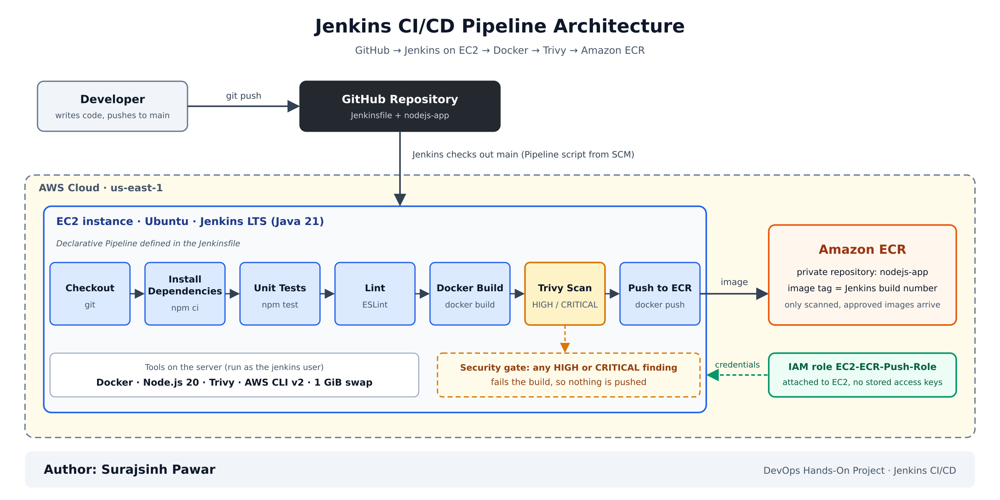

*Architecture diagram by Surajsinh Pawar.*

| Component | Role |
|---|---|
| GitHub | Stores the app code and the `Jenkinsfile` |
| Jenkins (EC2, Ubuntu) | Runs the pipeline from the `Jenkinsfile` |
| Docker | Builds the application image |
| Trivy | Scans the image and fails the build on HIGH or CRITICAL findings |
| Amazon ECR | Stores the image, tagged with the Jenkins build number |
| IAM role on EC2 | Gives Jenkins permission to push to ECR, so no access keys are stored |

## Repository structure

```
.
├── Jenkinsfile          # Declarative pipeline (repo root)
├── README.md
├── .gitignore
├── screenshots/         # Architecture diagram (00) and project screenshots (01-11)
└── nodejs-app/
    ├── Dockerfile
    ├── .dockerignore
    ├── package.json
    ├── package-lock.json
    ├── app.js
    ├── server.js
    ├── app.test.js
    └── eslint.config.js
```

## Pipeline stages

| Stage | What it does |
|---|---|
| Checkout | Fetches the code from GitHub |
| Install Dependencies | `npm ci` |
| Unit Tests | `npm test` (Node built-in test runner) |
| Lint | `npm run lint` (ESLint) |
| Docker Build | Builds `nodejs-app:<BUILD_NUMBER>` |
| Trivy Security Scan | `trivy image --severity HIGH,CRITICAL --exit-code 1` |
| Push to Amazon ECR | Logs in to ECR, tags and pushes the image |

The pipeline also uses `disableConcurrentBuilds()` and `skipDefaultCheckout(true)`, because the Checkout stage is explicit.

## Environment

- AWS EC2 instance `c7i-flex.large` (Ubuntu) in `us-east-1`, with a 16 GiB EBS volume and a 1 GiB swap file
- Jenkins LTS with the Pipeline, Git and Credentials plugins
- Docker, Node.js 20, Trivy and AWS CLI v2 installed on the server
- Jenkins runs as the `jenkins` Linux user, which was added to the `docker` group
- IAM role `EC2-ECR-Push-Role` with the `AmazonEC2ContainerRegistryPowerUser` policy, attached to the instance
- ECR private repository `nodejs-app` in `us-east-1`

## Setup summary

1. Create the ECR repository `nodejs-app`.
2. Create the IAM role (EC2 use case, ECR PowerUser policy) and attach it to the instance.
3. On the server, install Docker, Node.js, Trivy and AWS CLI, then check that the `jenkins` user can run each of them:
   ```bash
   sudo -u jenkins docker ps
   sudo -u jenkins node --version
   sudo -u jenkins trivy --version
   sudo -u jenkins aws sts get-caller-identity
   ```
4. In the `Jenkinsfile`, set `AWS_REGION`, `AWS_ACCOUNT_ID` and `ECR_REGISTRY` to your own values.
5. In Jenkins, create a **Pipeline** job with:
   - Definition: Pipeline script from SCM
   - SCM: Git, with this repository's URL
   - Branch specifier: `*/main`
   - Script path: `Jenkinsfile`
6. Click **Build Now**, then check the image tag in ECR.

## Screenshots

The images are stored in the `screenshots/` folder. The AWS account ID, public IP and instance IDs are blurred.

### 1. Server and AWS identity

| File | What it shows |
|---|---|
| `01-iam-identity-and-history.png` | Jenkins user authenticated as `EC2-ECR-Push-Role`, plus the install command history |
| `02-ec2-instance.png` | The running EC2 instance (`c7i-flex.large`, `us-east-1`) |

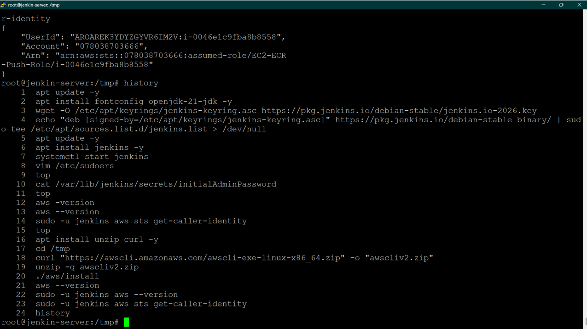
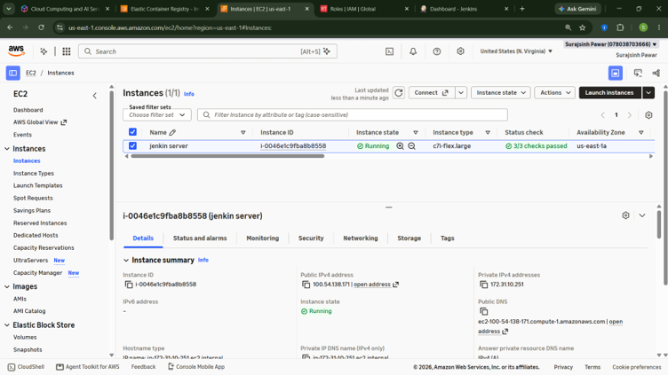

### 2. Failed builds and the Trivy security gate

| File | What it shows |
|---|---|
| `03-build2-dockerfile-typo-failure.png` | Build #2 fails at Docker Build because of the `WORDIR` typo |
| `04-build3-trivy-blocked.png` | Build #3 is stopped at the Trivy scan, so the image is not pushed |

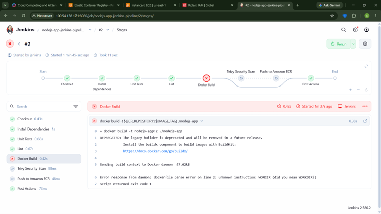
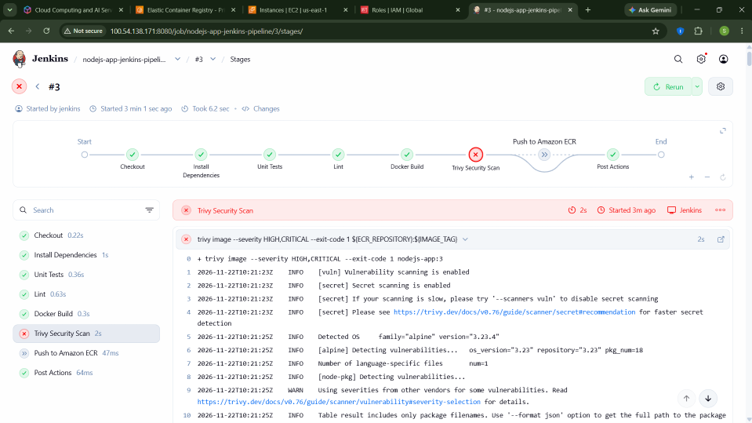

### 3. Fix and successful build

| File | What it shows |
|---|---|
| `05-local-container-test.png` | The hardened image runs locally and answers `Hello, Jenkins!` |
| `06-build5-success.png` | Build #5 passes all stages, including Trivy and the ECR push |

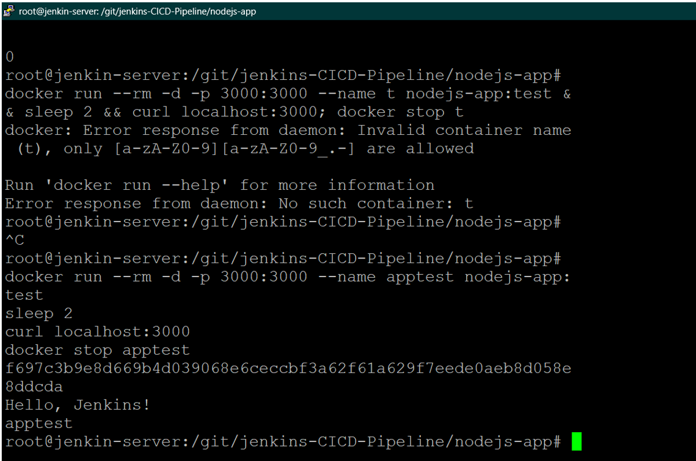
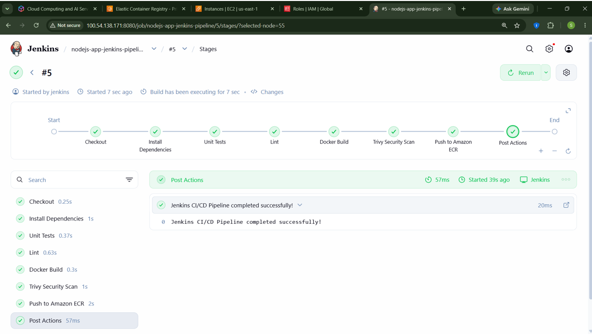

### 4. Jenkins overview

| File | What it shows |
|---|---|
| `07-build-history.png` | Builds #1 to #5: four failures, then one success |
| `08-jenkins-dashboard.png` | The `nodejs-app-jenkins-pipeline` job on the dashboard |

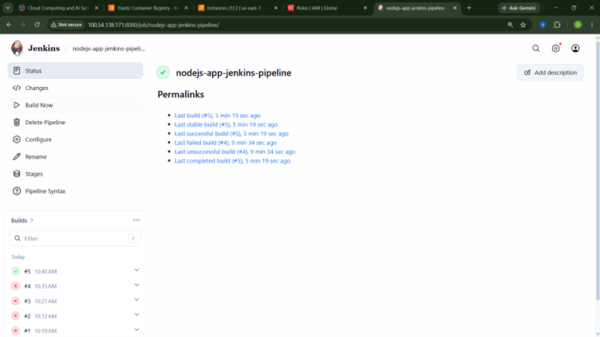
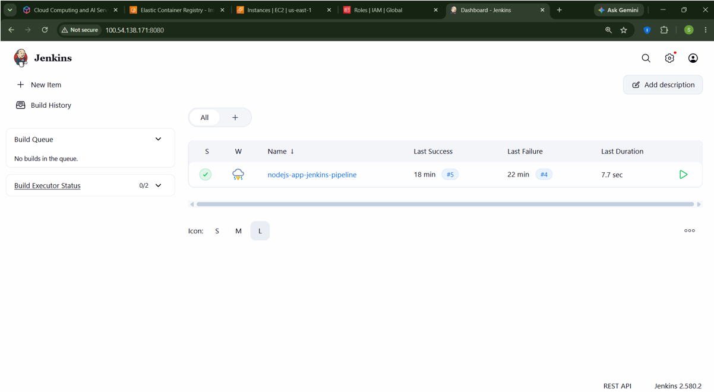

### 5. Amazon ECR

| File | What it shows |
|---|---|
| `09-ecr-repository.png` | The private repository `nodejs-app` |
| `10-ecr-image-tag-5.png` | The image pushed by Jenkins, tagged `5` (build number) |
| `11-ecr-image-details.png` | Image details: size 51.65 MB, status Active |

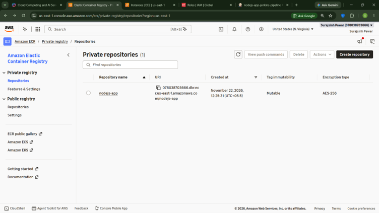
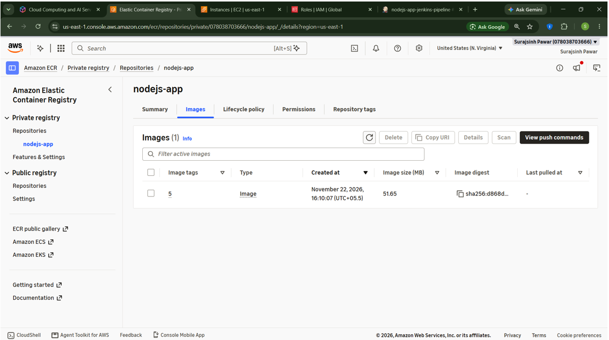
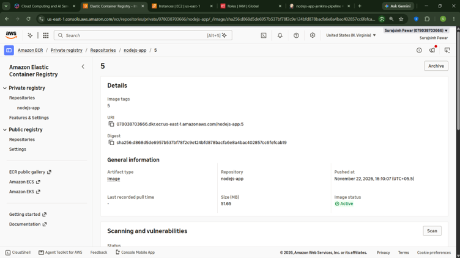

## Problems solved during the project

| Problem | Cause | Fix |
|---|---|---|
| `couldn't find remote ref refs/heads/master` | Jenkins branch specifier was the default `*/master` | Changed it to `*/main` |
| `unknown instruction: WORDIR` | Typo in the Dockerfile | Corrected to `WORKDIR` |
| Trivy failed the build with 29 HIGH/CRITICAL findings | Old Alpine packages and the `npm` bundled in the `node:20-alpine` image | Added `apk upgrade`, and removed `npm`/`yarn` from the final image, since the app only needs `node` at runtime |
| New Dockerfile not used by Jenkins | The commit had not been pushed to GitHub | Pushed to `origin main`, then rebuilt |
| Low disk space (about 1.6 GB free) | Small root volume | Enlarged the EBS volume, then ran `growpart` and `resize2fs` |

## Security notes

- AWS access uses the EC2 instance role. No access keys are stored in Jenkins or in this repository.
- The Jenkins dashboard (port 8080) should be restricted to your own IP, never `0.0.0.0/0`.
- Membership of the `docker` group is effectively root access on the server. This is acceptable for a lab, but production setups need safer isolation.
- A GitHub webhook needs port 8080 reachable by GitHub. For a lab, Poll SCM (`H/2 * * * *`) is a simpler alternative.
- In production, use a narrower IAM policy limited to one repository.

## Cleanup

To avoid AWS charges after the lab: delete the ECR images and repository, terminate the EC2 instance and check that no EBS volume remains, delete the IAM role, remove the port 8080 rule, and delete any webhook and personal access token.
